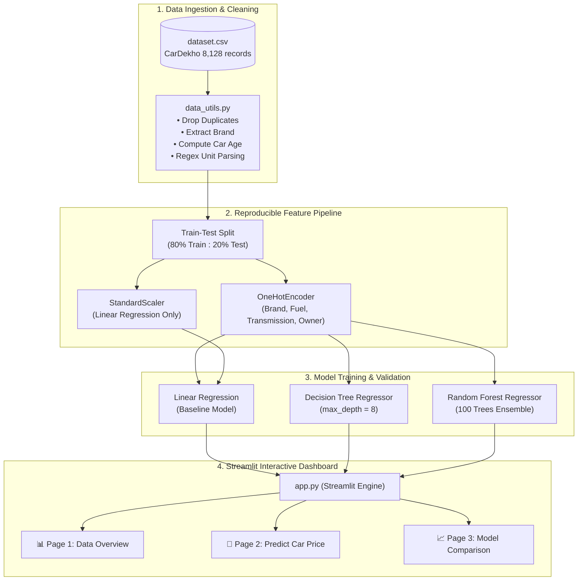
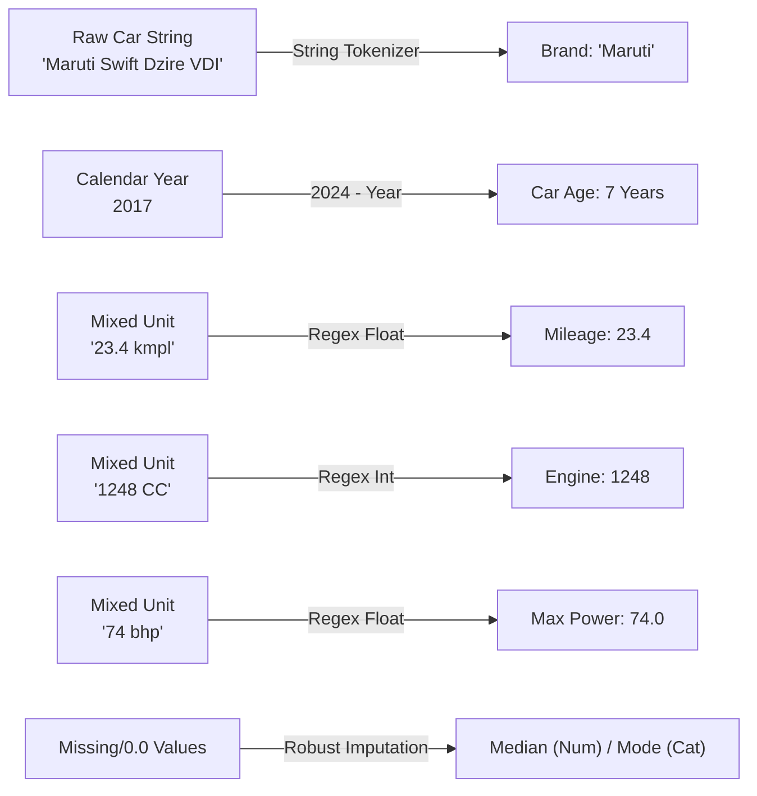
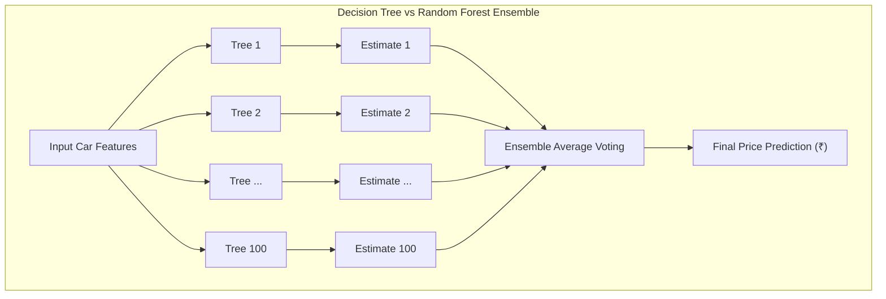
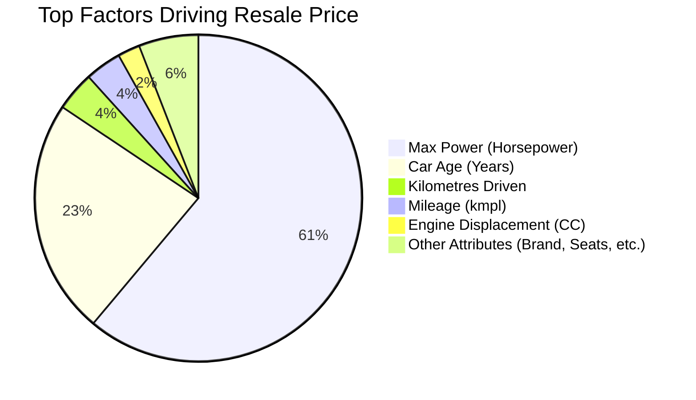

# 🚗 Used Car Price Prediction

<p align="center">
  
</p>

<p align="center">
  <strong>An end-to-end Machine Learning web application predicting resale vehicle prices in Indian Rupees (₹).</strong><br>
  Built with <strong>Python, Scikit-Learn, and Streamlit</strong> for academic evaluation and real-world utility.
</p>

<p align="center">
  
  
  
  
  
  
</p>

---

## 📌 Table of Contents

- [Overview & Problem Statement](#-overview--problem-statement)
- [System Architecture](#-system-architecture)
- [Data Preprocessing Pipeline](#-data-preprocessing-pipeline)
- [Machine Learning Models](#-machine-learning-models)
- [Benchmark Evaluation Results](#-benchmark-evaluation-results)
- [Feature Importance](#-feature-importance)
- [Dashboard Walkthrough](#-dashboard-walkthrough)
- [File Structure](#-file-structure)
- [Installation & Execution](#-installation--execution)
- [College Viva Q&A Guide](#-college-viva-qa-guide)
- [Author](#-author)

---

## 📖 Overview & Problem Statement

Valuing used automobiles is a major challenge in secondary markets due to multi-factor depreciation: car age, distance traveled, fuel tier, engine capacity, and brand perception. 

This project solves this challenge by developing a supervised regression pipeline trained on **6,926 verified car listings** from CarDekho (Kaggle). The application:
1. Conducts exploratory data analysis on vehicle pricing.
2. Trains and benchmarks three distinct regression algorithms under an identical 80/20 train-test split.
3. Provides an interactive web dashboard for real-time resale price estimation in Indian Rupees (**₹ Lakhs / Crores**).

---

## 🏛️ System Architecture



---

## ⚙️ Data Preprocessing Pipeline

Raw marketplace records contain mixed units and dirty strings that cannot be fed directly into Scikit-learn estimators. Our automated preprocessing pipeline executes the following transformations:



### Key Engineering Decisions:
- **`car_age` Transformation:** Absolute calendar year is arbitrary; vehicle depreciation is a function of elapsed years.
- **Brand Grouping:** Taking the first word prevents explosive high cardinality (e.g. 2,000+ individual trim variants) while capturing brand prestige tiers.
- **Torque Exclusion:** Dropped due to conflicting units (`Nm@rpm` vs `kgm@rpm`); engine CC and horsepower already capture mechanical output.

---

## 🤖 Machine Learning Models



### 1. Linear Regression (Baseline)
- Fits a hyperplane that minimizes residual sum of squares:
  $$\hat{y} = w_0 + w_1 x_1 + w_2 x_2 + \dots + w_n x_n$$
- Used to establish an experimental baseline.
- Numerical features are scaled via `StandardScaler` to prevent numerical overflow and gradient instability.

### 2. Decision Tree Regressor
- Recursively partitions feature space using variance reduction criteria.
- Captures non-linear thresholds (e.g., luxury brands depreciating exponentially faster).
- Constrained with `max_depth=8` to prevent leaf node memorization (overfitting).

### 3. Random Forest Regressor (Best Performer)
- Ensemble of 100 decision trees trained with **Bootstrap Aggregation (Bagging)** and random feature sub-selection.
- Effectively eliminates single-tree variance, providing superior generalization on unseen test data.

---

## 📊 Benchmark Evaluation Results

All models were evaluated on the **same held-out 20% test set (1,386 cars)** with `random_state=42`:

| Model Rank | Algorithm | MAE (Mean Absolute Error) | RMSE (Root Mean Squared Error) | $R^2$ Score (Accuracy) |
| :---: | :--- | :---: | :---: | :---: |
| 🥇 **1st** | **Random Forest Regressor** | **₹75,861** | **₹1,33,472** | **0.9188 (91.9%)** |
| 🥈 **2nd** | **Decision Tree Regressor** | ₹93,403 | ₹1,58,249 | 0.8858 (88.6%) |
| 🥉 **3rd** | **Linear Regression** | ₹1,32,973 | ₹2,61,704 | 0.6877 (68.8%) |

> [!NOTE]
> **Why Random Forest Won:** Tabular vehicle valuation problems have complex hierarchical dependencies (e.g. *Fuel Type* matters differently depending on *Engine Capacity*). Random Forest's 100-tree ensemble successfully captures these non-linear interactions without overfitting.

---

## 🔍 Feature Importance

Extracted from the fitted Random Forest estimator using MDI (Mean Decrease in Impurity):



1. **`max_power` (61.1%):** Horsepower is the strongest differentiator between budget commuters and premium luxury vehicles.
2. **`car_age` (23.3%):** Annual mechanical and technological depreciation.
3. **`km_driven` (3.9%):** Physical usage wear and tear.

---

## 🖥️ Dashboard Walkthrough

The application is structured into three dedicated views accessible via the sidebar:

### 1. 📊 Data Overview
- Summary metric cards: Total Records (6,926), Average Price (₹5.17L), Median Price (₹4.00L), Min Price (₹29,999), Max Price (₹1.00 Cr).
- **Log-Scale Histogram:** Visualizes skewed price distribution accurately.
- **Categorical Breakdown:** Average price by Fuel Type (Diesel vs Petrol vs CNG), Top 10 Manufacturers, and Manual vs Automatic split.
- **Dataset Inspector:** Interactive tabular preview with scrolling and sorting.

### 2. 🔮 Predict Car Price
- Dynamic dropdown selectors for **Brand**, **Fuel**, **Transmission**, **Seller Type**, and **Owner History**.
- Form inputs for **Car Age**, **Kilometres Driven**, **Mileage**, **Engine CC**, and **Horsepower** pre-filled with median defaults.
- One-click model switching (Linear Regression, Decision Tree, Random Forest).
- Immediate prediction output formatted in Indian Currency: e.g. `₹5.42 Lakhs (₹5,42,000)`.

### 3. 📈 Model Comparison
- Live metrics leaderboard highlighting the top-performing model.
- Side-by-side comparative bar charts for $R^2$ and MAE.
- **Actual vs. Predicted Scatter Plot:** Demonstrates point density along the $45^\circ$ perfect-prediction boundary.
- **Feature Importance Chart:** Visual ranking of top 15 predictors.

---

## 📁 File Structure

```text
used-car-price-prediction/
├── app.py                  # Streamlit dashboard interface & interactive charts
├── data_utils.py           # Ingestion, cleaning, feature engineering & statistics
├── model_utils.py          # Scikit-learn Pipeline construction, training & evaluation
├── requirements.txt        # Pinned core dependencies
├── README.md               # Project documentation & examination guide
├── dataset.csv             # Clean CarDekho dataset (8,128 records)
├── .gitignore              # Ignores venv/, cache, and bytecode files
└── .streamlit/
    └── config.toml         # Headless server & UI configurations
```

---

## 🚀 Installation & Execution

### 1. Clone the repository
```bash
git clone https://github.com/Vedu1630/Used-Car-Price-Prediction.git
cd Used-Car-Price-Prediction
```

### 2. Create and activate a virtual environment
```bash
# macOS / Linux
python3 -m venv venv
source venv/bin/activate

# Windows
python -m venv venv
venv\Scripts\activate
```

### 3. Install dependencies
```bash
pip install -r requirements.txt
```

### 4. Launch the dashboard
```bash
streamlit run app.py
```
Open **`http://localhost:8501`** in your browser.

---

## 🎓 College Viva Q&A Guide

<details>
<summary><strong>Q1: What type of machine learning problem is this?</strong></summary>
It is a <strong>Supervised Learning Regression problem</strong> because we have labeled historical data and are predicting a continuous numerical target (<code>selling_price</code>).
</details>

<details>
<summary><strong>Q2: Why did you choose Scikit-Learn Pipelines?</strong></summary>
A Scikit-Learn <code>Pipeline</code> bundles data transformations (One-Hot Encoding, Scaling) with the estimator. This ensures that new inputs from the Streamlit web form undergo the exact same mathematical transformations as the training data, preventing data leakage.
</details>

<details>
<summary><strong>Q3: Why did Random Forest outperform Decision Tree?</strong></summary>
A single Decision Tree has high variance and easily overfits noise in training data. Random Forest trains 100 randomized trees on bootstrap samples and averages their outputs, reducing overall variance and improving test generalization.
</details>

<details>
<summary><strong>Q4: Why was calendar year transformed into car age?</strong></summary>
Absolute years (e.g. 2018) are arbitrary labels. Depreciation in economics is directly proportional to elapsed time (<code>2024 - year</code>), giving the regression models a meaningful decay signal.
</details>

<details>
<summary><strong>Q5: What is the difference between MAE and RMSE?</strong></summary>
Both measure prediction error in ₹. While MAE averages absolute errors linearly, RMSE squares the errors before averaging, penalizing large outlier errors much more severely.
</details>

<details>
<summary><strong>Q6: Why did you scale numerical features for Linear Regression but not Tree models?</strong></summary>
Linear Regression calculates matrix dot-products and gradients which blow up when features have widely differing scales (e.g. 100,000 km vs 15 kmpl). Tree models only split on ordered thresholds ($X_i > c$), making them completely invariant to monotonic feature scaling.
</details>

<details>
<summary><strong>Q7: What does an R² score of 0.9188 mean?</strong></summary>
It means the Random Forest model explains <strong>91.88% of the total variance</strong> observed in used car resale prices on the unseen test set.
</details>

<details>
<summary><strong>Q8: What are the main limitations of this project?</strong></summary>
The dataset does not record physical inspection metrics (accidental history, paint scratches, tire tread depth, service records) or regional demand differences across Indian states.
</details>

---

## 👨‍💻 Author

- **Vedant Bhatt**  
  *B.Tech Computer Science Engineering*  
  *NMIMS University, MPSTME*  
  *GitHub:* [@Vedu1630](https://github.com/Vedu1630)
